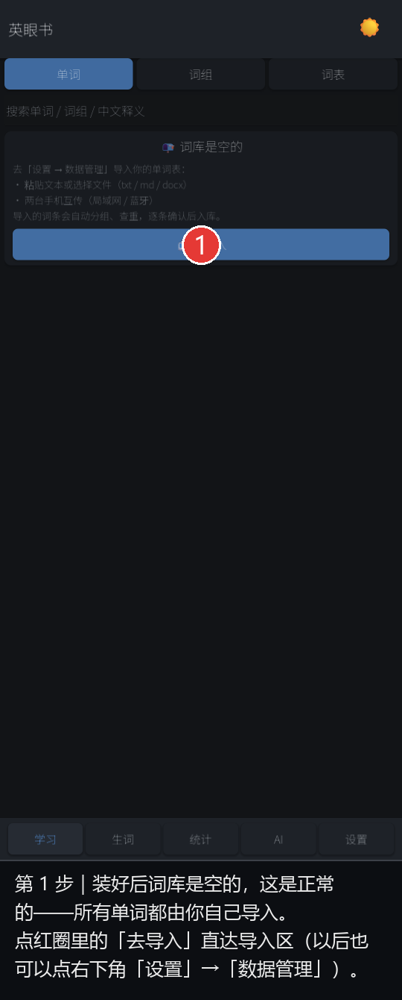
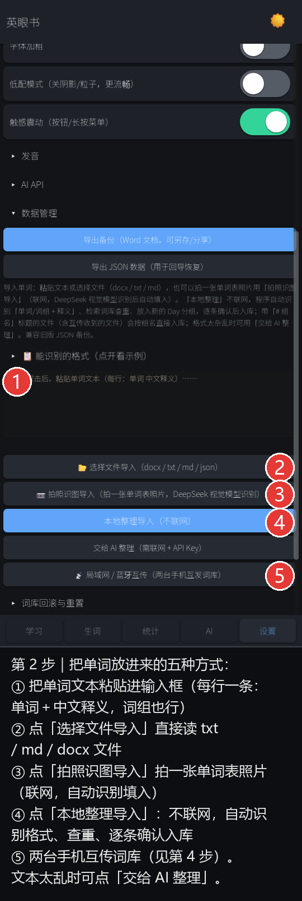
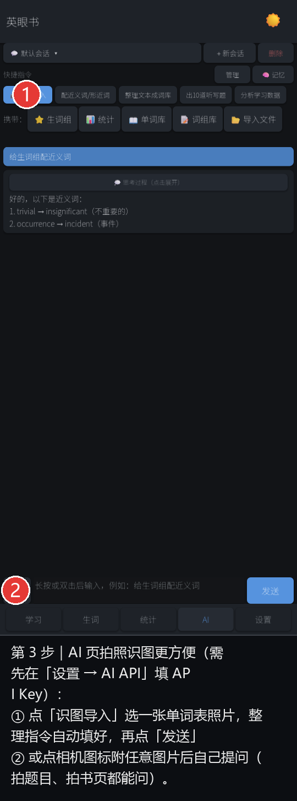
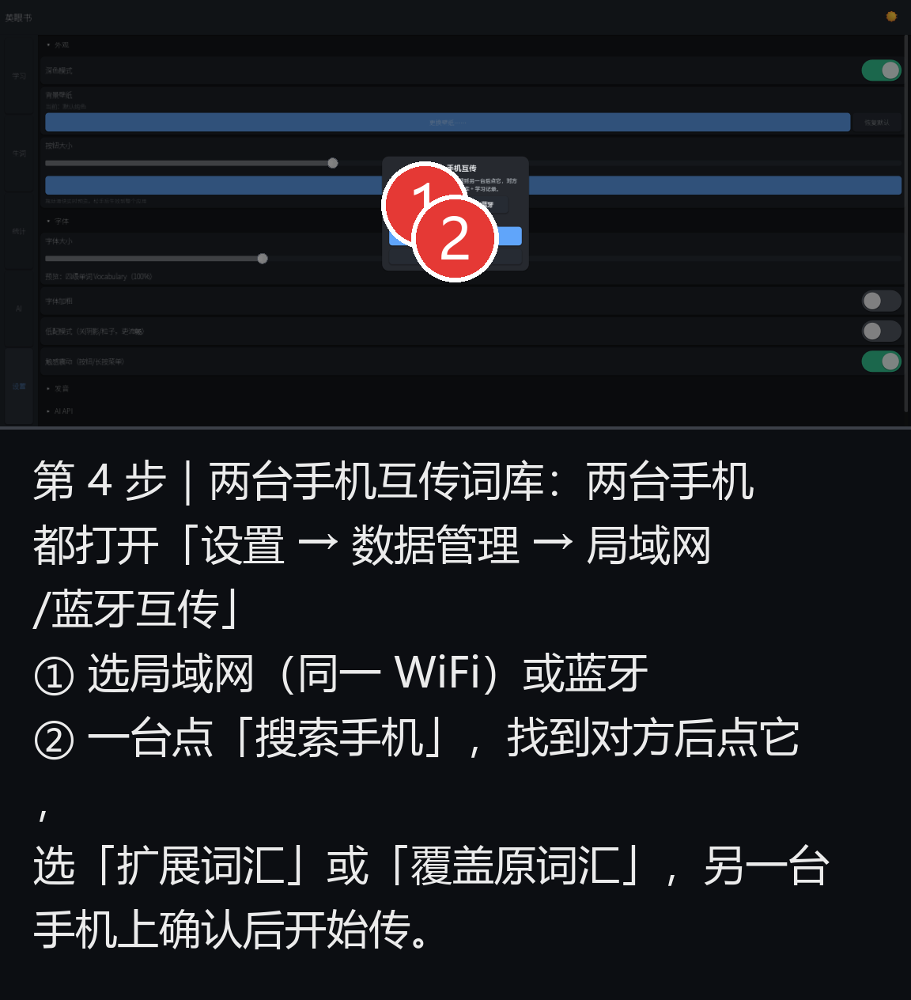

# 英眼书 · 新用户操作指南

> 软件装好后**词库是空的**，这是设计如此：所有单词 / 词组都由你自己导入，背什么完全由你决定。
> 支持英语、日语、韩语、法语、德语、西班牙语等（设置 → AI API → 学习语言）。

## 第 1 步：首次打开

主页会显示「词库是空的」和导入指引，点 **去导入** 按钮直达导入区。

## 第 2 步：把单词放进来（五种方式）

| 方式 | 适合场景 | 要不要联网 |
|---|---|---|
| ① 粘贴文本 → ④ 本地整理导入 | 从微信/网页/文档复制来的单词表 | 不联网 |
| ② 选择文件导入 | 现成的 txt / md / docx 单词文件 | 不联网 |
| ③ 拍照识图导入 | 纸质课本、手写单词表，拍一张照 | 联网（DeepSeek 识图，需 API Key） |
| ⑤ 局域网 / 蓝牙互传 | 同学直接把他的词库发给你 | 不联网（同 WiFi 或蓝牙） |
| 交给 AI 整理 | 文本格式太乱、程序认不出来 | 联网（需 API Key） |

导入时程序会自动识别格式、检索词库查重、按行确认后入库；带 `# 组名` 的文件会按组名直接分组。

## 第 3 步：AI 拍照识图（最省事）

AI 页第一个快捷按钮就是「识图导入」：选一张单词表照片 → 指令自动填好 → 点发送，AI 识别后逐条确认入库。也可以点输入框左边的相机图标，附任意图片自由提问（拍题目、拍书页都行）。

> 需要先做一次配置：设置 → AI API → 填入 API Key（DeepSeek 官网注册即得，识图不加价）。

## 第 4 步：两台手机互传

两台手机都打开 设置 → 数据管理 → 局域网/蓝牙互传：一台搜索、一台等待，找到对方点它，选「扩展词汇」（合并）或「覆盖原词汇」（替换），对方确认后开始传。学习记录不会随传，各背各的进度。

## 导入之后

- **学习**：主页点某组的「学习」→ 翻卡片（正面单词 / 背面释义），认识点 ✓，不认识点 ★ 进生词组
- **听写**：分组卡片的「听写」→ 听发音默写
- **生词**：底部「生词」页集中复习所有 ★ 标记
- **保险**：每次导入 / AI 修改前软件自动备份，设置 → 词库回滚与重置 可随时回到任意历史版本
